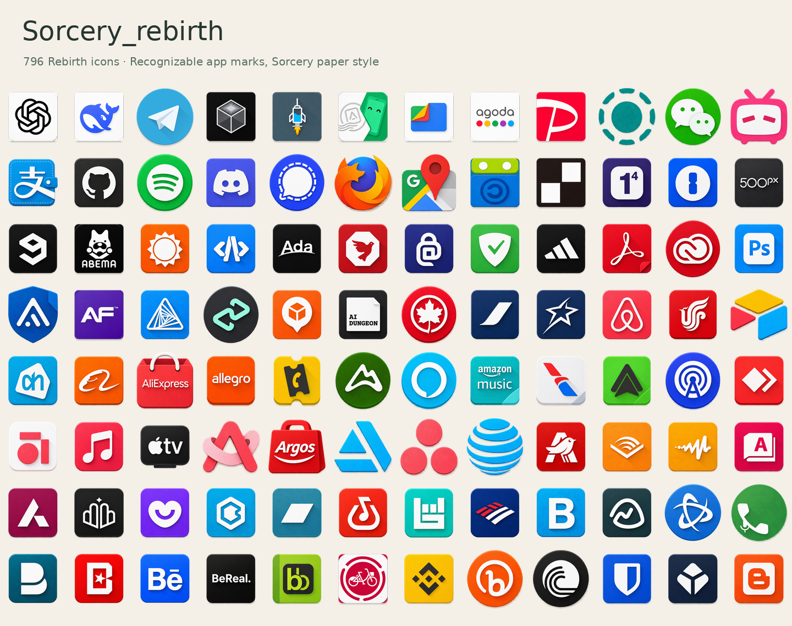

# Sorcery_rebirth

A continuation of [SorceryIconPack](https://github.com/sorcererxw/SorceryIconPack), with newly illustrated icons for modern Android apps. Vivid Material colors, paper layers and directional shadows follow the original Sorcery design language.

**[Download APK](https://github.com/4oOkSk/Sorcery_rebirth/releases/latest)** · **[Browse artwork](https://4ooksk.github.io/Sorcery_rebirth/)** · [中文说明](#中文) · [日本語](#日本語)



## What's included

- **796 Rebirth icons** cover publicly distributed Chinese, Japanese and global Android apps. Exact counts, regions and component totals are generated in [catalog/stats.json](catalog/stats.json).
- **1,683 original Sorcery PNGs** remain available alongside the new collection, for **2,479 icon resources**. Original artwork is identified in the gallery and dashboard.
- A searchable, offline Android dashboard and launcher icon picker. Android 8.0 or newer; no network or root permissions.
- A standalone [HTML gallery](docs/gallery.html), transparent PNG artwork, component mappings and a packaging script.

The new collection combines GPT-generated paper-style artwork with faithful adaptations of public application marks. Each icon preserves its application's recognizable logo, lettering and color relationships. Public app-store listings and upstream artwork supply identity references; Sorcery supplies the material and shadow style. Individual sources and artwork hashes are recorded in [catalog/icons.json](catalog/icons.json) and [third-party notices](THIRD_PARTY_NOTICES.md).

New source artwork is stored as transparent **384 × 384 PNGs**, normalized to Sorcery's optical sizes. The APK packages **192 × 192 PNGs** for launcher compatibility. The inherited collection retains its original PNG bytes. Building uses the checked-in artwork and does not call an image-generation service.

## Apply

Install the APK, then select **Sorcery_rebirth** in your launcher's icon pack settings or in Global Icon Pack. The package ID is `io.github.user4ooksk.sorceryrebirth`; it can coexist with the original Sorcery pack. Applying the theme is an explicit user action.

The pack supplies appfilter metadata, drawable metadata, an icon picker and a fallback background/mask with a `0.70` foreground scale. Launcher implementations differ; unsupported applications can use their launcher's fallback rendering. For Global Icon Pack's custom mask and sizing settings, see [compatibility](docs/compatibility.md).

Mappings are sourced from public application metadata and include multiple launcher activities where available. Release checks resolve all mapped resources; this does not mean every third-party app version has been tested on a device. Report a missing icon with its package and launcher activity.

## Build

Requirements: Python 3 with Pillow, JDK 17 or newer, `rsvg-convert` from librsvg, Android SDK Platform 35, and Build Tools 37.0.0. On Debian, install the image tools with `apt install librsvg2-bin python3-pil`. Builds use the official SDK tools directly and do not require Gradle or download dependencies.

```sh
python3 tools/generate.py
python3 tools/validate.py
python3 tools/build.py --sdk "$ANDROID_HOME" --jobs 4
```

The APK and checksum are written to `dist/`. The default build uses a locally generated development key in ignored `.local/`. For a release, provide your keystore and set `SORCERY_STORE_PASSWORD` in the environment:

```sh
python3 tools/build.py --sdk "$ANDROID_HOME" --keystore /path/to/release.p12 --alias sorcery
```

## Contribute artwork

Edit the transparent PNG in `artwork/icons/` and its entry in `catalog/icons.json`, then regenerate metadata with `python3 tools/generate.py`. Each entry needs a label, packages, actual launcher components, region, artwork format and source/license information. Update `generation.source_sha256` to match the edited PNG. Square faces occupy about 152/192 of the canvas; circular and freeform silhouettes can extend to 176/192. Keep logos readable at 48 px. The [art direction](docs/art-direction.md) describes the accepted style and generation prompt. Symbol SVGs in `artwork/glyphs/` are retained artwork references.

Use `docs/gallery.html` to review the full collection. Open it from a downloaded source archive or serve the repository with `python3 -m http.server`. Run `tools/validate.py` before building; it checks image format, transparency, source hashes, duplicate components and missing drawable references.

## License

Original Sorcery material and new project code are distributed under **GPL-2.0**. Simple Icons references retain CC0; the F-Droid adaptation retains CC-BY-SA-3.0. Public application marks remain subject to their owners' rights, as recorded in the catalog. See [LICENSE](LICENSE) and [THIRD_PARTY_NOTICES.md](THIRD_PARTY_NOTICES.md). Original Sorcery artwork is credited to sorcererxw and contributors; maintenance and art direction are by 4oOkSk.

## 中文

Sorcery_rebirth 延续原 Sorcery 的鲜明配色、纸片层次和阴影，收录 796 个面向公开发行应用的 Rebirth 图标。设计保留应用原有标志、字形和配色关系，以公开商店和上游素材核对辨识度。新图标以 384 像素透明 PNG 公开，APK 使用 192 像素版本；原版 1,683 张图标保持原始 PNG，共计 2,479 个图标资源。图标清单、来源、预览与构建脚本全部公开。

安装 Release 中的 APK，在桌面或 Global Icon Pack 中选择 **Sorcery_rebirth**。独立包名支持与原包共存。包内有离线搜索和图标选择界面，支持 Android 8.0 及以上。具体数量见 `catalog/stats.json`，来源按图标登记。

## 日本語

Sorcery_rebirth は Sorcery の鮮やかな配色、紙の質感と影を受け継ぐアイコンパックです。公開配布されている Android アプリ向けに、元のロゴ・文字・配色を尊重した 796 個の Rebirth アイコンを収録しています。新作は透明な 384 px PNG、APK 内では 192 px PNG です。従来の 1,683 個を合わせ、全 2,479 個のアイコンを収録しています。

Release の APK をインストールし、ランチャーまたは Global Icon Pack で **Sorcery_rebirth** を選択してください。Android 8.0 以降に対応し、元の Sorcery と共存できます。PNG 原画、対応アプリ一覧、出典、ギャラリー、ビルドツールを公開しています。
